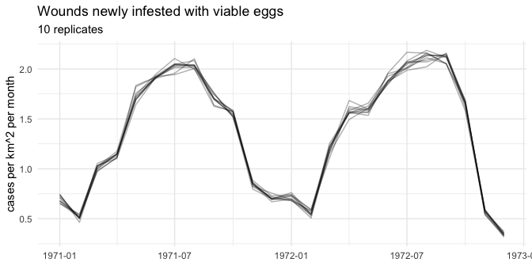

<!-- README.md is generated from README.Rmd. Please edit that file. -->

# SGDrivE <small>Screwworm Genetic-Control Dynamics Explorer</small>

<!-- badges: start -->

[](https://lifecycle.r-lib.org/articles/stages.html#experimental)
[](https://github.com/prateek1verma/SGDrivE/actions/workflows/R-CMD-check.yaml)
<!-- badges: end -->

SGDrivE will simulate genotype-resolved population dynamics of the New
World screwworm (*Cochliomyia hominivorax*) under genetic control: the
sterile insect technique (SIT), precision-guided SIT (pgSIT),
female-specific RIDL (fsRIDL) and gene drives.

> **Status: under development (milestone M5, outputs, checks and
> calibration, complete).** The package builds models, solves them
> deterministically (ODE) and stochastically (chain-binomial) with
> compiled C++ solvers checked against pure-R reference solvers and the
> legacy Gutierrez & Ponti (2014) model, and provides output tables,
> plots, model checks and calibration. Scientific validation follows in
> milestone M6. Do not use it for analysis yet.

## Planned model (v0.1)

| Component | Basis |
|----|----|
| Life history: degree-day development, temperature-dependent mortality, adult ageing chains, pre-oviposition period, wound-limited oviposition | Gutierrez & Ponti (2014) |
| Genotype inheritance, read from unmodified inheritance cubes | MGDrivE (Sanchez et al. 2020) |
| Mating: unmated → mated females, male availability | MGDrivE2 (Wu et al. 2021), adapted to NWS |
| Solvers: deterministic ODE and stochastic chain-binomial, one shared C++ rate kernel | SGDrivE |

Populations are tracked as counts per node. The full specification is in
[`dev/MODEL_SPEC.md`](dev/MODEL_SPEC.md) and the design decisions in
[`dev/DECISIONS.md`](dev/DECISIONS.md).

## Installation

The repository is private during development. With access:

``` r
# install.packages("remotes")
remotes::install_github("prateek1verma/SGDrivE")
```

A C++17 compiler is required (Xcode command line tools on macOS, Rtools
on Windows).

## Check the installation

``` r
library(SGDrivE)
sg_backend_info()
#> $package_version
#> [1] "0.0.0.9000"
#> 
#> $cplusplus
#> [1] 201703
#> 
#> $compiler
#> [1] "clang 21.0.0 (clang-2100.3.34.2)"
```

## Building a model (milestone M1)

``` r
# parameters (definitions: sg_param_table())
p <- sg_params()
# any MGDrivE inheritance cube
cube <- sg_cube(MGDrivE::cubeMendelian())
# daily forcing from the bundled McAllen, Texas weather
wx <- sg_forcing(sg_example_weather(), p, start = "1971-01-01", end = "1972-12-31")
# weekly releases of 500 adult males of genotype aa
rel <- sg_releases("aa", "adult", "male", times = seq(60, by = 7, length.out = 20), number = 500)
mod <- sg_model(p, cube, wx, rel, area = 1)
mod
#> <sg_model> 207 states; 3 genotypes; 731 days (1971-01-01 to 1972-12-31)
#>   sub-stages: eggs 3, larvae 6, pupae 10, adults 10 per sex
#>   female chain: [0, 61) dd: 3; [61, 202.8) dd: 7
#>   male chain: [0, 202.8) dd: 10
#>   node area 1 km^2; wounds H = 5 per node; mating "rate"; search competitors "searching_females"
#>   releases: 20 events on 20 days (days 60 to 193), 10,000 individuals
#>   hash: f057a3f76040568befa4ee309ec70ba9
```

## Deterministic simulation (milestones M2 and M3)

``` r
sim <- simulate_ode(mod) # compiled C++ solver (default)
sim
#> <sg_sim> 731 days (1971-01-01 to 1972-12-31), backend "cpp", method "dopri5"
#>   final totals: E 0.49452, L 0.30710, P 0.67484, M 0.47005, U 0.01378, F 0.45628
#>   eggs laid 2669.2; adults emerged 1229.2; released 10000
#>   solver: 17 steps/day (max 60), stiffness detected on 0 of 731 days, 0 integrated by the lsoda fallback, largest rate 13.5 per day, min state 0
#>   run time 0.03 s
```

`simulate_ode()` integrates the model one day at a time with a
Dormand-Prince 5(4) integrator written in C++. A day on which the
integrator detects stiffness is redone with `deSolve`’s `lsoda`. With
the defaults and McAllen weather that has not happened on any day of 24
years. `simulate_ode(mod, backend = "R")` runs the pure-R reference
solver instead: it gives the same results, 12 to 70 times more slowly.

Both solvers reproduce the legacy Gutierrez & Ponti (2014) ODE (one wild
genotype, `"gp2014"` preset) to a relative error below 10^-6 over
1960-1983 at McAllen, Texas. The C++ solver takes about 4.5 s for those
24 years, and about 1 s for 24 years of a two-genotype sterile-male
release model (benchmarks in [`bench/`](bench/README.md)).

## Stochastic simulation (milestone M4)

Counts are whole individuals per node, so the node area matters: with
the defaults (1 km^2, 5 wounds per km^2) a McAllen population falls
below one individual in most winters. Here a 1000 km^2 node starts from
a one-year burn-in of the ODE over the weather before the start date:

``` r
mod_1000 <- sg_model(p, cube, wx, rel, area = 1000)
init <- sg_init(mod_1000, "burn_in", weather = sg_example_weather())
sim_cb <- simulate_cb(mod_1000, init, n_rep = 10, seed = 1, keep = "totals")
sim_cb
#> <sg_sim_cb> 10 replicates x 731 days (1971-01-01 to 1972-12-31), dt = 0.1 day, eggs in batches
#>   final totals, mean [min, max] over replicates:
#>     E 533 [339, 674]
#>     L 325 [283, 395]
#>     P 692.7 [636, 739]
#>     M 466.3 [420, 493]
#>     U 13.3 [7, 19]
#>     F 454 [424, 492]
#>   extinct: 0 of 10 replicates
#>   wild type eliminated: 0 of 10 replicates
#>   eggs laid 2,674,116 and released 10,000 per replicate (mean)
#>   seed 1; run time 1.40 s
```

`simulate_cb()` divides each day into steps (0.1 day by default). Within
a step, individuals move along their sub-stage chains with the exact
probabilities of the chain over the step, die, mate, lay eggs and
emerge, with binomial, multinomial and Poisson draws; eggs are laid in
batches, as egg masses, by default. The mean of a step is within about
0.5% of the ODE. Each replicate has its own random-number stream, so it
is the same whether it runs alone, among others or in parallel
(`parallel = TRUE`). A two-genotype release model takes about 0.06 s per
simulated year and replicate, nearly independent of the number of
individuals. `extinct_day` and `wild_extinct_day` report when the
population, or its wild type, is gone.

For constant-temperature scenarios,
`sg_init(model, "equilibrium", temperature = 27)` gives the closed-form
equilibrium of a wild-type population.

## Outputs, plots, checks and calibration (milestone M5)

`check_model()` reports a model’s size, its fastest processes, the
season in which a wild population can grow (R0, eggs per egg at low
density, from `sg_r0()`), configuration problems and, for stochastic
runs, whether the population is large enough to persist:

``` r
check_model(mod_1000)
#> <sg_check>
#>   model: 3 genotype(s), 207 states, 731 days (1971-01-01 to 1972-12-31), node 1000 km^2, 5000 wounds
#>   releases: 20 event(s), 10000 individuals
#>   options: mating "rate", eggs in batches, search "searching_females", larval crowding "none", eggs at ambient temperature
#>   fastest sub-stage: 13.5 per day (1972-02-06); mating rate 0.693 per day (0.067 per step)
#>   R0 (eggs per egg at low density): 0 to 276; above 1 on 624 days (longest run 256); 230 at the mean temperature
#>   wild population (ODE after a one-year burn-in): 1.05e+03 to 5.99e+04 individuals per node
#>   memory per stochastic replicate: 1.38 MB (states) or 0.269 MB (totals)
#>   no problems found
```

The wound density sets the population size. `calibrate_wound_density()`
finds the density that gives a target, by default the mean adult density
over the model’s forcing period:

``` r
wx_1971 <- sg_forcing(sg_example_weather(), p, start = "1971-01-01", end = "1971-12-31")
cal <- calibrate_wound_density(sg_model(p, cube, wx_1971), target = 100) # adults per km^2
cal
#> <sg_calibration>
#>   wound_density = 18.4955 wounds per km^2 (proportional, 2 model runs)
#>   mean of adults per km^2: target 100, achieved 100 (relative difference 4.9e-13)
```

Output tables work the same for deterministic and stochastic results:
`sg_totals()` (by stage, sex, genotype and mate), `sg_allele_freq()`,
`sg_females()` (including females weighted by the fertility of their
mate) and `sg_cases()`, the case proxy: wounds newly infested with
viable eggs, so that females mated to sterile males cause no cases.

``` r
head(sg_cases(sim, period = "month", host_density = 20))
#>       period days     cases    events wound_fraction cases_per_host
#> 1 1971-01-01   31 0.6592521 0.6592525    0.004253240     0.03296261
#> 2 1971-02-01   28 0.5011765 0.5011818    0.003579832     0.02505883
#> 3 1971-03-01   31 1.0191002 1.0191603    0.006574840     0.05095501
#> 4 1971-04-01   30 1.1347996 1.1347996    0.007565330     0.05673998
#> 5 1971-05-01   31 1.7375602 1.7375602    0.011210066     0.08687801
#> 6 1971-06-01   30 1.9400709 1.9400709    0.012933806     0.09700354
```

`plot()` draws any of these with ggplot2 in colour-blind-friendly
colours; stochastic replicates are separate lines:

``` r
plot(sim_cb, "cases", period = "month")
```



The McAllen cold-stress index reproduces the values published by
Gutierrez & Ponti (2014) and Gutierrez et al. (2019):

``` r
ci <- sg_cold_index(sg_example_weather())
ci[ci$year %in% c(1971, 1979), c("year", "mu_cold")]
#>    year  mu_cold
#> 12 1971 6.667763
#> 20 1979 9.798071
```

## Roadmap

| Milestone | Content |
|----|----|
| M0 ✔ | Foundations: package skeleton, tests, linting, CI, design documents |
| M1 ✔ | Inputs: parameters, inheritance cubes, weather forcing, releases, model assembly |
| M2 ✔ | Reference genotype-resolved ODE in pure R |
| M3 ✔ | C++ rate kernel and ODE solver |
| M4 ✔ | C++ chain-binomial stochastic solver |
| M5 ✔ | Checks, summaries, calibration and plots |
| M6 | Scientific validation |
| M7 | Documentation and v0.1.0 release |

See [`dev/ROADMAP.md`](dev/ROADMAP.md) for completion criteria.

## References

Gutierrez, A.P. & Ponti, L. (2014). The new world screwworm: prospective
distribution and role of weather in eradication. *Agricultural and
Forest Entomology* 16:158–173. <https://doi.org/10.1111/afe.12046>

Sanchez C., H.M., Wu, S.L., Bennett, J.B. & Marshall, J.M. (2020).
MGDrivE: A modular simulation framework for the spread of gene drives
through spatially explicit mosquito populations. *Methods in Ecology and
Evolution* 11:229–239. <https://doi.org/10.1111/2041-210X.13318>

Wu, S.L. et al. (2021). MGDrivE 2: A simulation framework for gene drive
systems incorporating seasonality and epidemiological dynamics. *PLoS
Computational Biology* 17(5):e1009030.
<https://doi.org/10.1371/journal.pcbi.1009030>

## Licence

GPL (\>= 3).
